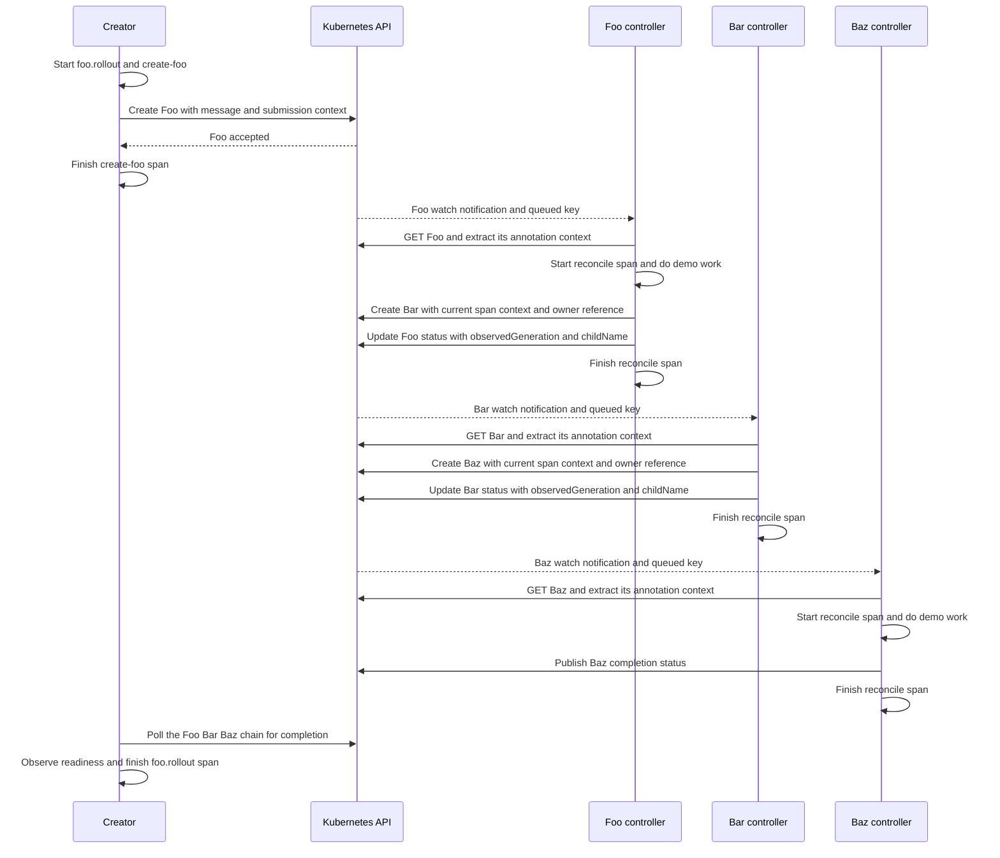

# Kubernetes tracing lab

A runnable Go/OpenTelemetry lab for following one desired-state change through
three Kubernetes controllers: **Foo → Bar → Baz**. Each resource has only
`spec.message` (a string). The controllers communicate through the API server,
not direct RPCs. Tempo stores the spans; Grafana shows the traces.

The original one-controller example now includes a queue, update handling,
persisted progress, retries, two tracing policies, and an explicit rollout span.
Your supplied notes in `tracing*.md`, merge-request examples, and the reference
`operatortrace/` checkout are left intact.

Read [tracing concepts](#trace-ids-span-ids-and-traceparent), follow the
[controller handoffs](#what-actually-passes-between-the-controllers), then use the
[code walkthrough](#navigate-the-code). The [span lifetime explanation](#when-does-a-span-end-what-is-a-rollout-span)
and [experiments](#experiments-and-expected-results) connect the code to its traces.

## Trace IDs, span IDs and traceparent

| Term | Meaning | In this lab |
| --- | --- | --- |
| Trace ID | 16 bytes, represented by 32 hex characters; groups spans | One desired-state operation in `child` mode |
| Span ID | 8 bytes, represented by 16 hex characters; identifies one span | New for every submission, attempt and work span |
| Parent span ID | The span an individual span follows | Controller 2 follows controller 1's successful reconcile |
| `traceparent` | Serialized trace ID, sending span ID and flags, plus format version | Stored in each resource's annotations, then extracted by its controller |
| `tracestate` | Optional vendor-specific tracing state | Propagated alongside valid traceparent; usually absent |
| Span link | Relationship to another span, possibly in a different trace | Used by `linked` mode and by a new update operation |

For example:

```text
00-4bf92f3577b34da6a3ce929d0e0e4736-00f067aa0ba902b7-01
│  │                                │                └ sampled flag
│  │                                └ sending span's ID
│  └ trace ID
└ version
```

On receipt, controller 1 extracts the sender's context and starts a **new span**.
With the child policy, its trace ID stays the same and its parent is the sending
span. When controller 1 injects context onward, traceparent contains controller
1's own span ID. Merely copying the original annotation would make controllers
2 and 3 siblings under the original sender, losing the intended chain.
These fields and their validation come from [W3C Trace Context](https://www.w3.org/TR/trace-context/).

`context.Context` is the in-process carrier for cancellation and the active span.
It does not cross the API server. `Inject` serializes the span context; `Extract`
restores it on the other side. An annotation carries identity, **not a live span**.
It cannot end, resume, or export the sender's span.

The Pod annotation `sidecar.opentelemetry.io/inject` is different: it asks the
OpenTelemetry Operator to add a collector container. It carries no trace identity.
The Foo's `tracing.example.com/traceparent` is the actual context carrier. Kubernetes
does not automatically copy HTTP trace headers into object annotations.

## What actually passes between the controllers?



The three Deployments watch **different kinds**:

| Controller | Watches | Creates |
| --- | --- | --- |
| 1 | Foo | Bar |
| 2 | Bar | Baz |
| 3 | Baz | No further resource; records completion |

All three kinds share the same minimal spec:

```yaml
apiVersion: example.com/v1
kind: Foo  # The next two objects are Bar and Baz.
metadata:
  name: foo-chain
spec:
  message: hello
```

There is no machine provisioning or domain model. Trace context and experiment
settings live in annotations. For example, **Bar** is created with:

```yaml
metadata:
  annotations:
    tracing.example.com/traceparent: 00-<trace-id>-<foo-controller-span-id>-01
    tracing.example.com/generation: "1"
    tracing.example.com/operation-id: <rollout-trace-id>
    tracing.example.com/root-uid: <foo-uid>
    tracing.example.com/root-generation: "1"
  ownerReferences:
    - apiVersion: example.com/v1
      kind: Foo
      name: foo-chain
      uid: <foo-uid>
      controller: true
spec:
  message: hello
```

Bar's controller extracts this context, starts its own reconcile span, and
injects that new span's context when creating Baz. **Each child spec and its
trace annotations are written together in a single Create request.** Owner
references express ownership and allow [Kubernetes garbage collection](https://kubernetes.io/docs/concepts/overview/working-with-objects/owners-dependents/).
They do not propagate trace context.

Each object stores its own `status.attempts`, `status.lastTraceID`, and
`status.observedGeneration`. Foo and Bar also store `status.childName`. Their
observedGeneration means **this controller finished its handoff**, not that the
whole chain is ready. The creator follows both child pointers and waits until
Baz completes, checking ownership and the originating Foo UID/generation.

Child names are deterministic per parent UID and generation. A retry reuses its
own existing child without overwriting the original creating span's annotation.
If creation succeeded but the parent's status write failed, the child may point
to that earlier attempt rather than the later successful status-writing attempt.
That preserves the actual creating context. A new Foo generation creates a new
Bar, which creates a new Baz; prior generations' children remain available for
inspection until their owner is deleted. This is tracing lab behavior, not a
rolling-update or replica management implementation.

Experiment controls are separate from the spec:

| Creator environment variable | Annotation propagated to children |
| --- | --- |
| `TRACING_MODE` | `tracing.example.com/mode` |
| `DELAY_MILLIS` | `tracing.example.com/delay-millis` |
| `FAIL_STAGE` | `tracing.example.com/fail-stage` |
| `FAIL_ATTEMPTS` | `tracing.example.com/fail-attempts` |

The creator translates its environment into annotations on Foo. The same controls
are inherited by Bar and Baz, so failure at stage 2 is a failure reconciling Bar.
Changing controls alone does not start a new operation on an already-completed
resource; use a new Foo or a new message/spec generation.

A watch notification prompts reconciliation of **current state**. It is not an
RPC from one controller to another. Keys can be coalesced, retries can happen,
and controllers can restart. That is why stages check persisted progress before
emitting spans. See [Kubernetes controllers](https://kubernetes.io/docs/concepts/architecture/controller/).

## When does a span end? What is a rollout span?

`span.End()` ends that one span. In this lab:

| Span | Starts | Ends |
| --- | --- | --- |
| `foo.rollout` | Creator begins one desired-state operation | Ready, timeout, superseded, cancellation, or API error |
| `create-foo` / `update-foo` | Creator submits the object | Kubernetes API call returns, including on error |
| `controllerN.reconcile` | Eligible worker attempt begins | Work, child creation (if any), and the status write finish, including on error |
| `write-to-disk` | Work begins inside an attempt | Delay and file write finish, or work fails |

`foo.rollout` is an **application-defined duration**, not a special OTel span type
or a Kubernetes built-in trace. Here it measures how long the creator observes
one Foo → Bar → Baz operation taking to become ready. It uses bounded polling
and checks the object's UID and generation, so it cannot mistake a later rollout for its own.
A submission may succeed while the rollout later times out.

There is **no whole-trace `End()`**. A child can start after its parent ended;
ending a parent does not cancel children. The span graph represents relationships,
not necessarily synchronous temporal nesting. Exporters send completed spans;
a backend may receive later spans with the same trace ID. Backend retention,
late-arrival handling and tail-sampling windows still limit what you will see.
See the [OpenTelemetry tracing API](https://opentelemetry.io/docs/specs/otel/trace/api/).

A trace is a collection of spans sharing a trace ID, not a distributed transaction
with an owner that can close every participant. The creator cannot know whether
a controller will retry or produce delayed work, so each participant ends its
own spans independently.

| Situation | Meaning and consequence |
| --- | --- |
| Every span has ended and no more arrive | The trace is historical telemetry. There is no live trace object waiting to be closed. |
| Code forgets to call `span.End()` | That span has an instrumentation bug. The normal SDK processor/export path does not receive it as a completed span. |
| New spans reuse one trace ID for months | The trace grows logically and mixes unrelated operations. Use bounded operation traces and links between them. |
| A backend's retention period expires | Stored telemetry can be removed even though an application still has the trace ID in an annotation. |

**No `EndTrace` does not mean indefinite storage or an immortal open transaction.**
Late-arrival behavior, retention, trace-size limits and tail-sampling windows are
backend/pipeline concerns. Do not assume an arbitrarily late span will be retained
or displayed together with all earlier spans. Our boundary is one desired-state
operation; a new operation gets a new trace.

`span.End()` controls telemetry timing. **Context cancellation controls work.**
Ending a span does not cancel a Kubernetes API call or stop another controller.
The timeout example deliberately demonstrates that distinction.

Do not keep a reconcile span open across several retries or while waiting for a
cloud operation for hours. End each attempt and persist an operation ID/context
for the next attempt. A rollout span is useful only when a component actually
owns a bounded observation interval. This demo's creator owns it; restarting the
creator does not reconstruct an unexported span. A production controller-owned
rollout needs a deliberate recovery design, persistent timestamps/operation IDs,
and often durable status plus metrics for availability across restarts.

## One trace or linked traces? When to start a new trace?

The lab offers both policies so you can inspect their different meanings.

**`TRACING_MODE=child`** keeps the whole operation in one trace:

```text
foo.rollout                                  [creator]
└─ create-foo                                [creator; ends at API response]
   └─ controller1.reconcile                   [controller1]
      ├─ write-to-disk
      ├─ controller2.reconcile attempt 1 ERROR
      │  └─ write-to-disk ERROR
      ├─ controller2.reconcile attempt 2 ERROR
      │  └─ write-to-disk ERROR
      └─ controller2.reconcile attempt 3
         ├─ write-to-disk
         └─ controller3.reconcile
            └─ write-to-disk
```

Retries have distinct span IDs, and follow the same successful upstream handoff.
The successful attempt hands its context to the next stage. They do not reuse
one span or automatically form a retry-to-retry chain. This policy suits this
controlled sequential pipeline; it does not prove arbitrary Kubernetes event
causality.

**`TRACING_MODE=linked`** starts a new trace per reconcile attempt and links its
root span to the upstream handoff. Work spans remain children of their local
attempt. The creator's rollout remains in its own trace. Follow links or inspect
each resource's `status.lastTraceID` and logs to find the other traces. They do not
appear as one nested waterfall; link navigation depends on the Grafana version.
This is useful when work is asynchronous, long delayed, retried or coalesced.
For fan-in, a span can have links to multiple causes; it has only one parent.
This lab implements a sequential pipeline, not fan-in or fan-out scheduling.

Suggested policy boundaries:

| Situation | Policy |
| --- | --- |
| Direct request or controlled stage of the same bounded operation | Continue the trace if one waterfall is useful |
| Retry of that stage | New span; same upstream parent or link |
| New user spec change / new desired-state operation | New trace; optionally link to the previous operation |
| Missing/invalid context | New root span; never invent a span ID from the object UID |
| Later resync or status-only event, with nothing to do | No new span in this lab |
| Independent repair after readiness, scheduled maintenance, deletion | Usually a new trace; link old context if useful |
| Multiple independent input changes coalesced by a queue | Consider a new trace with links to known causes |

One trace for an object's entire lifetime becomes huge and mixes unrelated
operations. `uid` identifies an object instance, `generation` identifies desired
state, and `resourceVersion` protects an individual API write. They are useful
attributes; none is a trace ID. Status writes use the status subresource, so they
do not increment generation.

The creator writes the new spec and annotation context atomically. It binds that
context to the expected generation. If you edit the spec using plain `kubectl`
and leave old annotations in place, controller 1 starts a new root instead of
joining the old trace. That root is then handed down to controllers 2 and 3.
Existing objects with unqualified `traceparent` annotations from the old demo
also take this fallback; new creator jobs use qualified annotation keys.

## Navigate the code

Read these files in order, starting with `child` mode and the successful `chain`
scenario. Then return to the retry and `linked` branches.

| File | Responsibility |
| --- | --- |
| [internal/tracing/tracing.go](internal/tracing/tracing.go) | Our utility wrappers around OpenTelemetry |
| [cmd/creator/main.go](cmd/creator/main.go) | Start one rollout, submit Foo and observe completion |
| [cmd/controller/main.go](cmd/controller/main.go) | Watch one kind, reconcile it and create the next resource |
| [internal/demo/demo.go](internal/demo/demo.go) | Resource selection, generation checks, names and chain readiness |

### OTel objects versus our utilities

Keep these types separate as you read:

| Object | Purpose |
| --- | --- |
| `TracerProvider` | Configures sampling, processing and exporting for this process |
| `Tracer` | Creates spans; obtaining one does not start a trace |
| `Span` | One operation, with a start time and an `End()` method |
| `SpanContext` | Tracing identity: trace ID, span ID, flags and tracestate |
| `context.Context` | Go's in-process carrier for cancellation and the current span |

A tracer is reusable across many operations. A span context is identity, not a
live handle to the sending process's span. Extracting it cannot resume or end
that span.

These functions are **our code**, built on top of OTel:

| Our utility | What it does | Starts or ends a span? |
| --- | --- | --- |
| [`Init`](internal/tracing/tracing.go#L19) | Configures the exporter, sampling, batching and service name | Neither |
| [`InjectToMap`](internal/tracing/tracing.go#L54) | Serializes the current span's identity into traceparent and tracestate | Neither |
| [`ExtractFromMap`](internal/tracing/tracing.go#L66) | Parses those fields and returns a context carrying the remote identity | Neither |
| [`InjectAnnotations`](internal/tracing/tracing.go#L77) | Adds our annotation prefix and preserves unrelated annotations | Neither |
| [`ExtractAnnotations`](internal/tracing/tracing.go#L90) | Reads our prefixed annotations and calls `ExtractFromMap` | Neither |
| [`StartAttempt`](internal/tracing/tracing.go#L99) | Chooses a parent or link, then calls `tracer.Start` | Starts one span |

`otel.Tracer`, `tracer.Start`, `span.End`, `span.RecordError`, `span.SetStatus`,
`span.SetAttributes` and the `trace.With...` options come from OTel itself.
There is no custom `StartRollout` function: `foo.rollout` is an ordinary span
with an application-specific name and lifetime.

### Process initialization: `Init`

Read [`Init`](internal/tracing/tracing.go#L19) by its blocks:

1. Read `OTEL_EXPORTER_OTLP_ENDPOINT`, defaulting to `localhost:4317`.
2. Create an OTLP/gRPC exporter to send telemetry to that destination.
3. Attach `service.name` to distinguish creator and controller telemetry.
4. Create a provider with parent-based sampling and a batching processor.
5. Register the provider globally and configure W3C trace-context propagation.
6. Return `tp.Shutdown` so the process can flush and close its telemetry pipeline.

`resource.New(...)` here constructs **telemetry metadata**, such as the service
name. It does not create a Kubernetes resource. The propagation helpers explicitly
use `propagation.TraceContext{}` to serialize and parse W3C context.

The creator and each controller call `Init` once when their process starts.
Their deferred shutdown code uses a fresh context with a 10-second timeout so
flushing can run even if the controller's working context has been cancelled.

**Shutdown does not end application spans.** `span.End()` finishes one operation;
provider shutdown flushes already-completed spans and closes the exporter.
The deferred calls are arranged so the creator ends its rollout before shutting
down the provider. See the [OTel SDK lifecycle](https://opentelemetry.io/docs/specs/otel/trace/sdk/).

### Creator: start the root, submit Foo, then wait

In [`creator.run`](cmd/creator/main.go#L31), the opening blocks initialize tracing,
create the Kubernetes client, read experiment settings, and prepare Foo. For an
update, the code can add a link to the previous operation's stored context.

The normal trace starts at this statement:

```go
ctx, rollout := otel.Tracer("crd-creator").Start(
    ctx,
    "foo.rollout",
    append(options, trace.WithNewRoot())...,
)
defer rollout.End()
```

| Expression | How to read it |
| --- | --- |
| `otel.Tracer("crd-creator")` | Obtain a tracer from the configured provider |
| `.Start(...)` | Create a span |
| `"foo.rollout"` | Give the span a meaningful operation name |
| `trace.WithNewRoot()` | Request a new trace even if the incoming context contains a span |
| Returned `ctx` | A new Go context containing this rollout span |
| Returned `rollout` | The span handle used to attach information and end the measurement |
| `defer rollout.End()` | End this span when `run()` returns, including on an error return |

OTel generates the trace ID and span ID. The root's returned context is passed
to [`submitAndWait`](cmd/creator/main.go#L118), which creates a submission span:

```go
submitCtx, submit := otel.Tracer("crd-creator").Start(ctx, action+"-foo")
```

Because `ctx` already carries the rollout and this call does not request a new
root, `create-foo` or `update-foo` is its child. It keeps the trace ID and receives
a new span ID.

Next, `tracing.InjectAnnotations(submitCtx, obj.GetAnnotations())` serializes the
**submission span's** context into Foo. The creator adds the generation binding
and operation ID, then sends spec and annotations together in Create or Update.
The missing, invalid and unsampled branches deliberately alter that handoff for
the relevant experiments.

`submit.End()` runs as soon as the API call returns. It does not wait for Foo's
controller, Bar or Baz. The rollout span continues while the creator polls.

[`demo.ChainReady`](internal/demo/demo.go#L101) follows Foo's and Bar's child
pointers and checks that the entire current chain has completed. This is
application readiness logic; it creates or ends no spans. The polling also
rejects a replaced Foo or newer generation, so old work cannot satisfy a new
rollout.

Once polling succeeds, times out, is cancelled, or returns an error, `run()`
returns and its deferred `rollout.End()` executes. Errors are recorded and set
the rollout span's status to Error before it ends.

### Controller: start and finish one attempt

All three controllers use the same binary. `CONTROLLER_STAGE` selects Foo, Bar
or Baz. [`controller.run`](cmd/controller/main.go#L35) initializes tracing,
starts the informer, queues resource keys, and invokes `reconcile`. Failed
attempts are requeued with backoff.

Read [`reconcile`](cmd/controller/main.go#L103) in this order:

1. Split the queued key into namespace and name, then GET current state.
2. Use `demo.Eligible` to skip a deleting object or an already-completed generation.
3. Determine the attempt number from persisted status.
4. Call `demo.Incoming` to validate the annotation generation and read its context.
5. Start an attempt span and attach kind, UID, generation and correlation attributes.
6. Do demo work and, for Foo or Bar, create the next resource.
7. Record completion or failure in status and return.

The central tracing calls are:

```go
incoming := demo.Incoming(u, stage)
ctx, span := tracing.StartAttempt(
    ctx, tracer, stageName+".reconcile",
    demo.Setting(u, "mode"), incoming,
    // Span attributes are passed here in the implementation.
)
defer span.End()
```

The returned `ctx` now carries **this attempt's span**. That is why both
`work(ctx, ...)` and `ensureChild(ctx, ...)` receive it: nested work and outgoing
annotations must use the current attempt, not its upstream sender.

`defer span.End()` runs on success and on ordinary error returns. An error status
does not itself end a span: `RecordError` adds exception information, `SetStatus`
marks the operation as failed, and `End` finishes its timing. Each retry starts
a fresh span rather than reopening the previous one.

### Inside `StartAttempt`: parent or link

[`StartAttempt`](internal/tracing/tracing.go#L99) begins with:

```go
remote := trace.SpanContextFromContext(
    ExtractFromMap(context.Background(), carrier),
)
```

This parses the incoming identity in a separate context. It does not create a
recording span. The worker's cancellation and values are preserved through the
original `ctx` used below.

In `child` mode, `trace.ContextWithRemoteSpanContext(ctx, remote)` places that
identity into the worker context as the parent. In `linked` mode,
`trace.WithNewRoot()` requests a separate trace and `trace.WithLinks(...)` adds a
relationship to the valid remote span. Missing or invalid input has no valid
remote parent or link.

The last line, `return tracer.Start(ctx, name, attrs...)`, is the actual OTel
span-creation call. In child mode, valid input supplies the trace ID and parent
span ID; OTel creates a new span ID. Without valid input it creates a new root.

### Nested work and the outgoing child

[`work`](cmd/controller/main.go#L161) calls:

```go
_, span := tracer.Start(ctx, "write-to-disk")
```

The work span is a child of the reconcile span carried by `ctx`. Its deferred
function records a work error if necessary and then calls `span.End()`. The
returned context is discarded because there are no deeper instrumented calls
inside `work` that need it.

[`ensureChild`](cmd/controller/main.go#L191) constructs Bar or Baz, assigns its
owner reference, injects the current reconcile context, and creates it. This
function creates no additional span; its execution is measured within reconcile.
The tracing handoff is this line:

```go
annotations := tracing.InjectAnnotations(ctx, parent.GetAnnotations())
```

This helper copies unrelated annotations but replaces traceparent and tracestate.
Bar receives Foo's controller span ID, and Baz receives Bar's controller span ID.
For an already-existing child from a prior attempt, the code verifies ownership
and preserves the original creating context rather than rewriting history.

### The remaining demo helpers

These functions support the lab rather than define OTel's span lifecycle:

| Helper in `internal/demo/demo.go` | Purpose |
| --- | --- |
| `Client`, `Env` | Kubernetes client setup and environment configuration |
| `Resource`, `Kind`, `StageName` | Map the controller stage to its resource and name |
| `Number`, `Text`, `Setting`, `SettingNumber` | Read object fields and annotations |
| `Eligible` | Decide whether this resource generation needs work |
| `Incoming` | Reject stale tracing annotations and return the valid carrier |
| `OperationID` | Supply a correlation attribute; it does not generate an OTel trace ID |
| `ChildName`, `OwnedBy` | Make retries reuse the correct child and verify ownership |
| `ChainReady` | Decide whether the creator's observed rollout has completed |

### Reading path for one complete operation

```text
tracing.Init
    ↓
creator.run: start foo.rollout
    ↓
submitAndWait: start create-foo → inject into Foo → finish create-foo
    ↓
controller.reconcile: read context → StartAttempt
    ↓
work: start and finish a nested work span
    ↓
ensureChild: inject current context into Bar or Baz
    ↓
reconcile returns → finish attempt span
    ↓
creator observes ChainReady → finish foo.rollout
```

With a manually created Foo that has no valid trace annotations, Foo's controller
starts a new trace at `StartAttempt`. Bar and Baz can continue it in child mode,
but that path has no creator-owned rollout span. In linked mode each reconcile
starts a separate trace with an upstream link when valid context is available.

## Deploy the lab

Use a test cluster and check your selected context first. The manifests use the
`default` namespace, local images, demo RBAC, ephemeral Tempo storage and anonymous
Grafana access.

1. Install cert-manager and the OpenTelemetry Operator using their installation
   instructions (links/commands are in `manifests/02-otel-collector-sidecar.yaml`).
   Wait for their deployments and webhooks to be ready.
2. Apply the infrastructure and updated CRD:

   ```bash
   kubectl config current-context
   kubectl apply -f manifests/00-crd.yaml
   kubectl wait --for=condition=Established crd/foos.example.com crd/bars.example.com crd/bazs.example.com --timeout=60s
   kubectl apply -f manifests/01-rbac.yaml
   kubectl apply -f manifests/02-otel-collector-sidecar.yaml
   kubectl apply -f manifests/05-tempo.yaml
   kubectl apply -f manifests/06-grafana.yaml
   kubectl rollout status deploy/tempo --timeout=120s
   ```

3. Build images and load them into your cluster:

   ```bash
   ./build.sh                             # build only
   # Or choose one destination:
   LOAD_TARGET=kind ./build.sh
   # LOAD_TARGET=minikube ./build.sh
   # LOAD_TARGET=k3d K3D_CLUSTER=my-cluster ./build.sh
   # LOAD_TARGET=ssh REMOTE_NODES='node-01 node-02' ./build.sh
   ```

   The SSH option preserves the original containerd import workflow, now selected
   explicitly. For a registry-based cluster, push images and change manifest image
   fields. `go.sum` is included for reproducible dependency resolution.

4. Start the three controllers and submit the first operation:

   ```bash
   kubectl apply -f manifests/04-controller-deployment.yaml
   kubectl rollout status deploy/foo-controller --timeout=120s
   kubectl rollout status deploy/foo-controller-2 --timeout=120s
   kubectl rollout status deploy/foo-controller-3 --timeout=120s
   kubectl apply -f manifests/03-creator-job.yaml
   kubectl logs -f job/foo-creator
   kubectl get foos.example.com,bars.example.com,bazs.example.com
   kubectl get foo foo-chain -o yaml
   ```

The controller Pods use injected collector sidecars. Short-lived creator Jobs
export directly to Tempo: a classic injected sidecar can keep a completed Job
running. The creator ends spans before flushing the SDK, on success and errors.
Both paths export the same OTLP data to the same backend.

Rebuilding a `:local` image does not replace an existing Pod. Reload the image and
restart the three Deployments before testing new code.

## Experiments and expected results

Run one scenario at a time with the helper (requires `kubectl` and Python 3):

```bash
./scripts/run-scenario.sh retry
# Copy the printed Job name:
kubectl logs -f job/<printed-job-name>
```

The helper creates unique Job/Foo names and disables Job retries so a failed
rollout is easy to inspect. The YAML files can also be applied directly, using
the fixed names shown below. Do not apply all scenario manifests recursively:
`update` depends on `foo-chain` already existing, and timeout intentionally fails.

| Scenario | Direct manifest | What to look for |
| --- | --- | --- |
| `chain` | `manifests/03-creator-job.yaml` | Three controllers, one trace, one successful rollout |
| `retry` | `manifests/scenarios/retry.yaml` | Stage 2 fails twice, then succeeds; three sibling attempt spans |
| `linked` | `manifests/scenarios/linked.yaml` | New trace for each attempt, linked to upstream; one injected retry |
| `missing` | `manifests/scenarios/missing.yaml` | Creator trace separate from a new controller root |
| `invalid` | `manifests/scenarios/invalid.yaml` | Same fallback, without crashing or accepting invalid context |
| `unsampled` | `manifests/scenarios/unsampled.yaml` | Creator visible; controller IDs in logs/status but no exported controller spans |
| `timeout` | `manifests/scenarios/timeout.yaml` | Creator Job fails after a 1s readiness wait; controllers finish later |
| `slow` | `manifests/scenarios/slow.yaml` | 5s work per stage: time to restart a controller or supersede the operation |
| `update` | `manifests/scenarios/update.yaml` | Same Foo UID, higher generation, new rollout trace linked to the previous operation |

For a **new generation**, first complete the initial `foo-chain` operation:

```bash
./scripts/run-scenario.sh update foo-chain
```

The helper changes `MESSAGE` each time, so repeated updates create distinct
spec changes. Applying the fixed update YAML again does not rerun its completed
Job; prefer the helper for repeat experiments.

For **supersession**, start `slow`, read its Foo name from logs, then run `update`
against it while the first rollout is pending. The first creator detects the
new generation and ends its rollout with `rollout.outcome=superseded`. An old
attempt's conflicting status write cannot mark the new generation complete;
the worker fetches current state on retry. Intermediate generations can be
coalesced: the demo does not promise to execute every submitted change.

For **restart recovery**, start `slow` and restart controller 2 during its work:

```bash
kubectl rollout restart deploy/foo-controller-2
```

It lists Bars and resumes from each object's persisted progress. Completed stages
are skipped, so restarting an already-ready controller should add no spans.
An interrupted file write/attempt can be repeated; progress is not exactly-once
execution. Keep one replica per stage: multiple replicas need leader election
or work partitioning beyond this lab.

For **stale annotations**, after `foo-chain` is ready, submit a plain spec edit:

```bash
kubectl patch foo foo-chain --type=merge -p '{"spec":{"message":"manual desired-state change"}}'
```

Controller 1's new trace ID differs from the stored creator trace ID because
the annotation generation no longer matches. For **deletion during a rollout**,
delete a pending slow Foo: the creator reports the API error and ends its span.
There is no finalizer/deletion controller in this lab.

In the timeout experiment, look up the creator's trace again after the controllers
finish. Their later spans can still use the original trace ID. `rollout.outcome`
remains `timeout`: it describes the observer's deadline, not cancellation of the
desired state. Only ended spans are available to the exporter, so a still-running
rollout will not yet be visible as a completed span.

The unsampled experiment explicitly clears the sampling flag in the persisted
handoff. The SDK uses `ParentBased(AlwaysSample())`: roots are sampled, but
children of an unsampled remote parent are not recorded. Propagation and work
still happen. This flag is a sampling signal, not an instruction to stop work.
A linked new root makes a separate sampling decision. Head sampling cannot
recover errors from spans it never recorded; retaining all errors with tail
sampling requires those candidate spans to reach the collector first.

## Inspect the traces

```bash
kubectl port-forward svc/grafana 3000:3000
# Open http://localhost:3000 -> Explore -> Tempo -> trace ID from creator logs
```

Or query Tempo directly in another terminal:

```bash
kubectl port-forward svc/tempo 3200:3200
curl -s http://localhost:3200/api/traces/<TRACE_ID> | jq .
```

Useful correlation fields are `trace_id`, `span_id`, `k8s.object.uid`,
`k8s.object.generation`, `controller.stage`, `reconcile.attempt`, and `operation.id`.
The operation attribute remains the creator rollout ID even when linked spans
use different trace IDs. For a manual spec edit with stale annotations, it falls
back to UID plus generation rather than naming an old creator operation.
After missing/invalid context, read
Foo's `status.lastTraceID` to find the controller trace.
Allow a few seconds for SDK/collector batching before treating absent spans as
lost context. Client-go/API-server HTTP spans are not instrumented in this lab:
persisting an annotation is separate from tracing API transport calls.

Each stage writes `/tmp/<Kind>-<namespace>-<name>.json` in its own
container before publishing completion. With distroless images, inspect it
through an ephemeral debug container if needed. The file is a snapshot taken
before that stage's status update, not the final state of the object.

## Local checks and scope

```bash
go test ./...
go vet ./...
```

Tests inspect real in-memory OTel span records and use Kubernetes fake clients
to exercise context propagation, parent/link relationships, error retries,
readiness, timeout, supersession, generation changes, idle suppression and status
conflicts, actual child creation and owner/context handoffs. Fake clients do not
validate CRD schemas or model watch/relist behavior fully; run the manifests on a test cluster for end-to-end verification.

This is an educational lab: one worker per controller, no leader election,
one child per parent per generation and a local file write, no fan-out/fan-in implementation,
no controller-owned durable rollout reconstruction, and no production retention
or sampling pipeline. It intentionally filters completed status-only work;
production controllers must also handle external drift and referenced inputs
that can change independently of the top-level object's generation.
